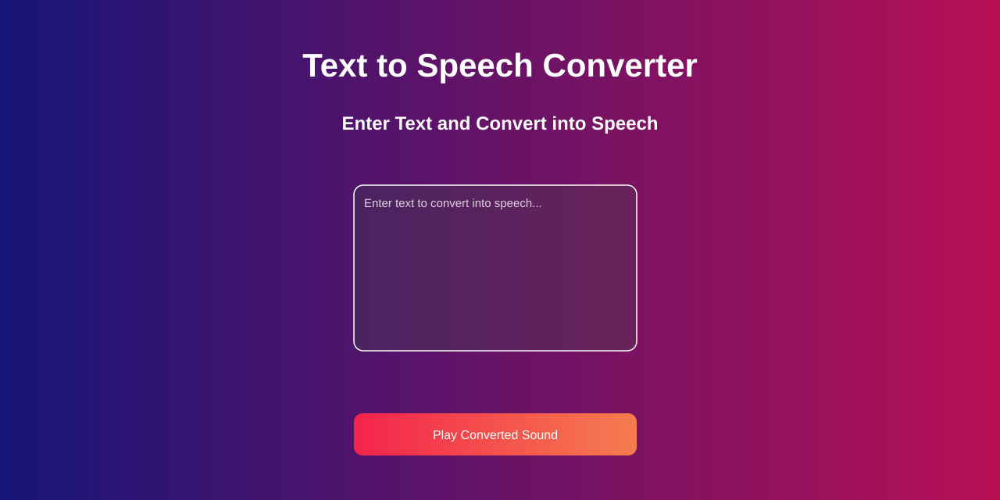

# Text to Speech Converter

A lightweight, browser-based text-to-speech app. Enter text and let your browser read it aloud using the Web Speech API—no build step or server-side service required.

## Preview

## Features

- Converts entered text to speech with the browser's built-in speech synthesis.
- Shows a message when you try to play without entering text.
- Provides a simple, responsive interface with a gradient background.
- Runs directly in the browser; no dependencies or installation are needed.

## Getting started

1. Download or clone this project.
2. Open `index.html` in a modern browser.
3. Type or paste text into the text area.
4. Select **Play Converted Sound** to hear it read aloud.

You can also serve the project with any static web server if you prefer.

## Browser support

Speech playback relies on the browser's `SpeechSynthesis` and `SpeechSynthesisUtterance` APIs. Use a current browser that supports the Web Speech API, and make sure your device's audio is enabled. The available voice and pronunciation are provided by the browser and operating system.

## Project files

| File | Purpose |
| --- | --- |
| `index.html` | App layout and page content |
| `style.css` | App styling |
| `script.js` | Text validation and speech playback |
| `screenshot.svg` | App preview image used above |

## How it works

When the button is clicked, `script.js` checks that the text area contains non-whitespace text and that speech synthesis is not already speaking. It then creates a `SpeechSynthesisUtterance` and passes it to `window.speechSynthesis.speak()`.

The app uses the browser's default voice. It does not upload or store the entered text.

## Limitations

- Voice choices and speech quality depend on the browser and installed system voices.
- The button label returns to its idle text after five seconds; this is a fixed timer and may not match the actual speech duration.
- The page loads the Poppins font from Google Fonts; if that font cannot be reached, a sans-serif fallback is used.
